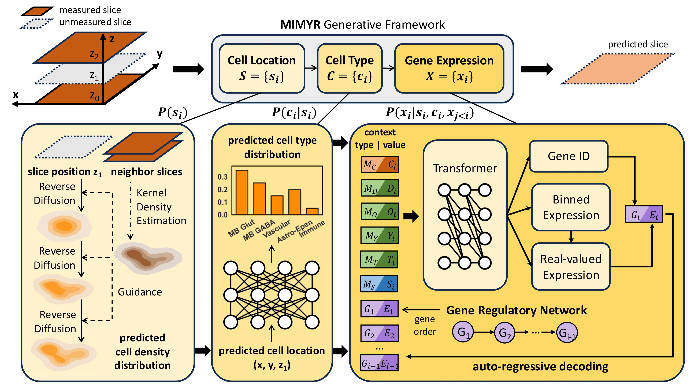

# MIMYR

MIMYR is a generative framework for spatial transcriptomics. Given neighboring
tissue sections registered to the Allen Common Coordinate Framework (CCF), it
generates an unseen section: where the cells are, what type each cell is, and
what genes each cell expresses.

It has three components, run in sequence:

1. **Location model**: a conditional diffusion model (DDPM) that samples cell
   coordinates in the plane of the new section, with optional backward guidance
   from a KDE fit to a neighboring reference section.
2. **Cell-type model**: a classifier that predicts each cell's type from its CCF
   coordinates.
3. **Expression model**: an autoregressive transformer that generates each cell's
   expression profile, conditioned on its location and cell type.

---

## Installation

MIMYR requires Python 3.10 or newer. It is not on PyPI yet, so install it from
source.

```bash
conda create --name mimyr python=3.10
conda activate mimyr
```

If you have an NVIDIA GPU, first install the PyTorch build that matches your CUDA
version (see [pytorch.org](https://pytorch.org/get-started/locally/)); otherwise
`pip` installs the default build.

Then, from the repository root:

```bash
pip install -e .
```

This installs the `mimyr` package and its dependencies. The gene and cell-type
metadata the models need ship with the package.

## Quickstart

From the repository root:

```bash
python main.py
```

This runs the full pipeline (location, cell type, and expression) with the
pretrained models on a small demo dataset in `demo_data/`. It generates one
section from its two neighbors and scores it against the real section, using the
model and settings behind the paper's Fig. 2. The first run downloads that model's
checkpoints (about 475 MB) from the Hugging Face Hub. The metrics are written to
`results/output.csv` and the generated section to `artifacts/`.

The demo data is the first rq1 test section (`sec_14`) and the two reference
sections next to it (`sec_13`, `sec_15`), each randomly subsampled to 5% of its
cells (3,562 to 4,719 cells per section). Because the sections are subsampled, its
scores are not comparable to the paper's. `demo_data/make_demo_data.py` rebuilds it
from the full rq1 data.

---

## Pretrained models and data

The pretrained checkpoints are hosted on the Hugging Face Hub at
[gkrieg13/mimyr](https://huggingface.co/gkrieg13/mimyr), and the benchmark data at
[gkrieg13/mimyr-data](https://huggingface.co/datasets/gkrieg13/mimyr-data). Both are
downloaded on first use and cached by `huggingface_hub` (`~/.cache/huggingface` by
default; set `HF_HOME` to move it).

`--pretrained` selects one of the models from the paper. It provides any checkpoint
you do not pass explicitly, and the inference settings used for that model in the
paper:

| `--pretrained` | Paper | Use with | Settings it applies |
|---|---|---|---|
| `merscope` (default) | Fig. 2 | `--data_mode rq1` or `demo` | reference guidance 75, `--metric_filter_by_gt` |
| `zhuang1` | Fig. 3, zero-shot | `--data_mode rq3_v2` | reference guidance 75, `--metric_filter_by_gt`, `--omit_x` |
| `zhuang2-finetuned` | Fig. 3 | `--data_mode rq3_v2` | reference guidance 75, `--metric_filter_by_gt`, `--omit_x` |
| `zhuang3-finetuned` | Fig. 4 | `--data_mode rq4` | reference guidance 50, `--metric_filter_by_gt` |

Settings are resolved in this order, each overriding the previous one: the built-in
defaults, the `--pretrained` model's settings, a `--config` file, and flags on the
command line. For example, `--wtf_strength_gene 0 --wtf_strength_bin 0
--wtf_strength_value 0` turns reference guidance off.

Benchmark data is downloaded only for the data mode you run (the demo needs none) and
extracted into `--data_dir` (default `data/`):

| Archive | Size | Contents | Data modes |
|---|---|---|---|
| `rq1-merscope.zip` | 1.3 GB | 53 MERSCOPE sections from one brain | `rq1` |
| `Zhuang-ABCA-1.zip` | 1.0 GB | Zhuang-ABCA-1 (147 sections) | `base_zhuang1`, `rq4_noref` |
| `Zhuang-ABCA-2.zip` | 0.4 GB | Zhuang-ABCA-2 (66 sections) | `rq3`, `rq3_v2*`, `rq4_rq3` |
| `Zhuang-ABCA-3.zip` | 0.5 GB | Zhuang-ABCA-3 (23 sagittal sections) | `rq4*` |
| `Zhuang-ABCA-4.zip` | 0.05 GB | Zhuang-ABCA-4 (3 sections) | none |

These sections come from the Allen Brain Cell Atlas (Yao et al., *Nature* 2023; Zhang
et al., *Nature* 2023); please cite those papers if you use them.

### Input format

Each section is an `.h5ad` file (`.slaf` is also supported) with:

- `obs["x_ccf"]`, `obs["y_ccf"]`, `obs["z_ccf"]`: CCF coordinates, which MIMYR
  stacks into `obsm["aligned_spatial"]`
- `obs["cluster"]`: cell-type labels (choose a different column with `--data_label`).
  Labels are mapped to tokens using the bundled Allen Brain Cell atlas vocabulary,
  so they must use ABC-atlas names.
- `X`: the gene expression matrix

---

## Running inference

`main.py` is the entry point. It loads a dataset according to `--data_mode`,
generates each test section from its neighboring reference sections, scores the
result against the real section, and writes the metrics to a CSV.

Each of the three stages is controlled by its own flag:

| Flag | Default | Values |
|---|---|---|
| `--location_inference_type` | `model` | `model` (DDPM), `closest_slice` (copy the nearest reference section) |
| `--cluster_inference_type` | `model` | `model` (classifier), `majority_baseline` |
| `--expression_inference_type` | `model` | `model` (transformer), `lookup` (nearest same-type reference cell), `averaging` |

Every stage also accepts two special values:

- `skip` uses the **ground truth** for that stage instead of predicting it
  (useful for evaluating one stage in isolation).
- `end` stops the pipeline after the previous stage.

The defaults run every stage with its model. To run the full pipeline on the rq1
benchmark instead of the demo:

```bash
python main.py --data_mode rq1 --out_csv results/rq1.csv
```

To evaluate the expression model alone, given the true locations and cell types:

```bash
python main.py --location_inference_type skip --cluster_inference_type skip
```

The baselines used in the paper:

```bash
python main.py --data_mode rq1 \
  --location_inference_type closest_slice \
  --cluster_inference_type majority_baseline \
  --expression_inference_type lookup \
  --metrics soft_spearman_correlation,soft_f1 --metric_sampling 100
```

`main_experimental_results.sh` lists the commands behind the paper's experiments.
Several of them point at checkpoints on the lab's cluster that are not in the
download.

### Data modes

`--data_mode` selects the dataset and the train/validation/test/reference split:

| Mode | Dataset | Paths it reads |
|---|---|---|
| `demo` (default) | one rq1 test section and its two neighbors, subsampled to 5% | `--demo_data_dir` (default `demo_data/`) |
| `rq1` | coronal sections from one brain, fixed held-out sections | `--data_dir/subclass_z1_d338_0_rotated/` |
| `rq3`, `rq3_v2`, `rq3_v2_d1` … `rq3_v2_d4` | Zhuang-ABCA-2 (coronal); the `_d*` modes vary the distance to the reference sections | `--zhuang_data_dir/Zhuang-ABCA-2/`, `--data_dir/ccf-ABCA-2.csv` |
| `rq4`, `rq4_rq3`, `rq4_noref` | Zhuang-ABCA-3 (sagittal); `rq4_noref` uses all of Zhuang-ABCA-1 as the reference pool | `--zhuang_data_dir/Zhuang-ABCA-3/` (and `-1`, `-2`), `--data_dir/ccf-ABCA-*.csv` |
| `rq5` | diseased (Trem2 / 5xFAD) sections; not distributed, so supply your own | `--diseased_data_dir` |
| `base_zhuang1` | Zhuang-ABCA-1, for training the base models | `--zhuang_data_dir/Zhuang-ABCA-1/` |

### Main options

- `--pretrained`: which pretrained model to use (see above)
- `--location_model_checkpoint`, `--cluster_model_checkpoint`, `--expression_model_checkpoint`:
  use these checkpoint files instead of the `--pretrained` model's
- `--guidance_signal`: strength of KDE backward guidance for the location model
  (default `0.0`, off); `--kde_bandwidth` sets the KDE bandwidth (default `0.01`)
- `--metrics`: comma-separated metrics (default
  `soft_accuracy,soft_spearman_correlation,soft_f1`). Available:
  `soft_accuracy`, `soft_spearman_correlation`, `soft_correlation_top_100`, `soft_f1`,
  `gridized_l1_distance`, `gridized_kl_divergence`, `celltype_abundance`,
  `composition_entropy`, `composition_pairwise`, `delauney_colocalization`.
  Results go in one column per radius, e.g. `soft_f1_radius@0.05`
- `--metric_sampling`: percentage of ground-truth cells the metrics are computed
  on (default `100`)
- `--metric_gene_set_file`: restrict expression metrics to the genes listed in a
  file, one per line (e.g. `gene_overlap.txt`); `--metric_filter_by_gt` restricts
  them to genes expressed in the ground truth
- `--eval_workers`: number of sections scored in parallel (default `1`)
- `--device`: `cuda` (default) or `cpu`

Expression decoding can be tuned with `--top_k`,
`--expression_select_max_index_margin`, and the weak teacher forcing options
(`--expression_weak_teacher_forcing`, `--wtf_*`), which pull generation toward the
nearest same-type reference cell. The `--pretrained` model sets the guidance
strength; see `python main.py --help` for the full list.

### Output

- `--out_csv` (default `results/output.csv`): one row per test section, containing
  the full configuration and the metrics. Rows are appended, and a section is
  **skipped** if a row with the same configuration is already in the CSV.
- `--artifact_dir` (default `artifacts/`): one timestamped folder per test section
  with `config.json`, `results.json`, `pred.pkl` (the generated AnnData), and plots
  of the predicted and ground-truth locations and cell types.

---

## Training

### Expression model

`--run_mode train` trains the expression transformer with distributed
data-parallel training. Launch it with `torchrun`:

```bash
torchrun --nproc_per_node=<NUM_GPUS> main.py \
  --run_mode train \
  --skip_combined_fit \
  --data_mode rq1 \
  --expression_output_dir /path/to/save/checkpoints \
  --expression_epochs 265 \
  --expression_batch_size 128
```

This fine-tunes the `--pretrained` model's expression transformer (by default
`merscope`, saved at epoch 165) for 100 more epochs. To try training on the demo data,
run `torchrun --nproc_per_node=1 main.py --run_mode train --skip_combined_fit --expression_epochs 166`.

- Training and validation data come from the `--data_mode` split, the same as for
  inference. The preprocessed data is cached in `--expression_output_dir`, so later
  runs with the same output directory skip preprocessing.
- A checkpoint is saved every `--expression_save_frequency` epochs (default `10`).
- Training starts from the weights in `--expression_model_checkpoint` and
  continues its epoch count from the `epochN` in the checkpoint's filename.
  `--expression_epochs` is the **last epoch number**, not a count: starting from the
  `merscope` model (epoch 165), `--expression_epochs 265` trains epochs 166 to 265.
- `--expression_random_init` uses only the checkpoint's architecture and starts from
  random weights. To train from scratch without a checkpoint, pass
  `--expression_model_checkpoint ""` together with
  `--expression_model_size small|medium|large`.
- Training logs to Weights & Biases. Set `WANDB_MODE=offline` to log locally.

Other useful options: `--expression_lr` (default `5e-5`), `--expression_lambda_val`
(weight of the regression loss, default `1.0`), `--expression_max_len` (default
`512`), `--expression_epoch_samples` (cells per epoch; `-1`, the default, uses all of
them), `--expression_xyz_noise` / `--expression_xyz_noise_magnitude` (coordinate
noise), and `--expression_adata2` (an extra `.h5ad`, e.g. scRNA-seq, merged into
training).

### Cell-type and location models

Without `--skip_combined_fit`, `--run_mode train` first trains the cell-type
classifier on the `.h5ad`/`.slaf` files in `--training_slice_directory` and
`--val_slice_directory` (default `data/cleaned_versions`). These files also need an
`obs["token"]` column. The best model is saved to `./best_model.pt`.

`main.py` does not train the location model. `train_location_zhuang1.py` and
`train_celltype_zhuang1.py` retrain the location and cell-type models on
Zhuang-ABCA-1; they currently contain cluster-specific data paths.

### Configuration files

Any option can be put in a YAML file and passed with `--config`. Each key is an
argument name (for example `data_dir:` or `expression_model_checkpoint:`), and flags
given on the command line override the file:

```bash
python main.py --config config.yaml
torchrun --nproc_per_node=4 main.py --config configs/train_base.yaml --run_mode train
```

`config.yaml` and the files in `configs/` hold the settings for the paper's
experiments. They contain absolute paths on the lab's cluster, so copy one and
change the paths before using it. Because they set their checkpoints and guidance
explicitly, they are not affected by `--pretrained`.

---

## Project structure

```
MIMYR/
├── pyproject.toml               # Package definition (pip install -e .)
├── main.py                      # Entry point: inference and training
├── demo_data/                   # Small demo dataset (default data_mode)
├── hub/                         # Hugging Face model and dataset cards
├── scripts/                     # Maintainer scripts for publishing to the Hub
├── config.yaml                  # Example configuration
├── configs/                     # Per-experiment configurations
├── main_experimental_results.sh # Commands for the paper's experiments
├── gene_overlap.txt             # Shared gene set for rq1/rq3 evaluation
├── train_location_zhuang1.py    # Retrain the location model on Zhuang-ABCA-1
├── train_celltype_zhuang1.py    # Retrain the cell-type model on Zhuang-ABCA-1
└── src/mimyr/                   # The installable `mimyr` package
    ├── pretrained.py            # Pretrained models and data on the Hugging Face Hub
    ├── data_loader.py           # SliceDataLoader: data modes, splits, preprocessing
    ├── inference.py             # The three-stage generation pipeline
    ├── evaluator.py             # Runs the selected metrics
    ├── metrics.py               # Metric implementations
    ├── gene_exp_model.py        # Cell-type label to token mapping
    └── models/
        ├── diffusion_model.py        # Location model (DDPM)
        ├── celltype_model.py         # Cell-type classifier
        ├── biological_model.py       # KDE used for location guidance
        ├── combined_model.py         # Loads the location and cell-type models
        └── generative_transformer/   # Expression model
            ├── Mimyr.py              # Generation and inference helpers
            ├── finetune_mimyr.py     # Training loop (DDP)
            ├── data_util.py          # Data harmonization and loaders
            ├── metadata/             # Bundled gene and cell-type metadata
            ├── model/                # Transformer implementation
            ├── reference/            # Gene symbol reference list
            └── utils/                # Tokenizer
```

## Citation

If you use MIMYR, please cite:

> Deshpande A, Bei Z, Ma J, Krieger S. MIMYR: Generative modeling of missing tissue
> in spatial transcriptomics. *bioRxiv* [Preprint]. 2025 Nov 27:2025.11.24.690239.
> doi: [10.1101/2025.11.24.690239](https://doi.org/10.1101/2025.11.24.690239).
> PMID: 41394599; PMCID: PMC12697367.

```bibtex
@article{deshpande2025mimyr,
  title   = {{MIMYR}: Generative modeling of missing tissue in spatial transcriptomics},
  author  = {Deshpande, A. and Bei, Z. and Ma, J. and Krieger, S.},
  journal = {bioRxiv},
  year    = {2025},
  doi     = {10.1101/2025.11.24.690239},
  note    = {Preprint. PMID: 41394599; PMCID: PMC12697367}
}
```

## License

MIMYR is released under the [MIT License](LICENSE).
